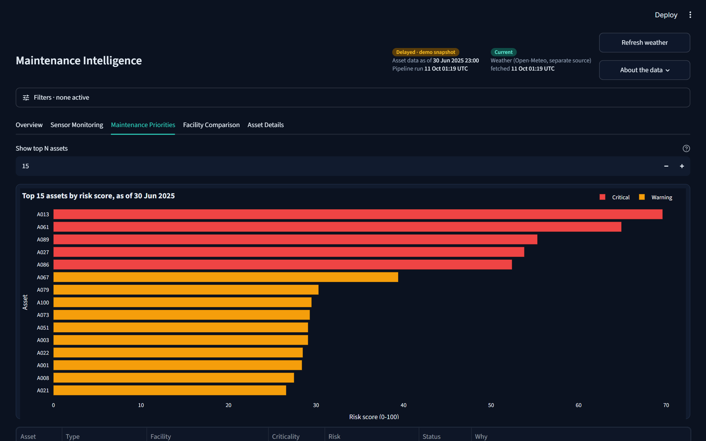
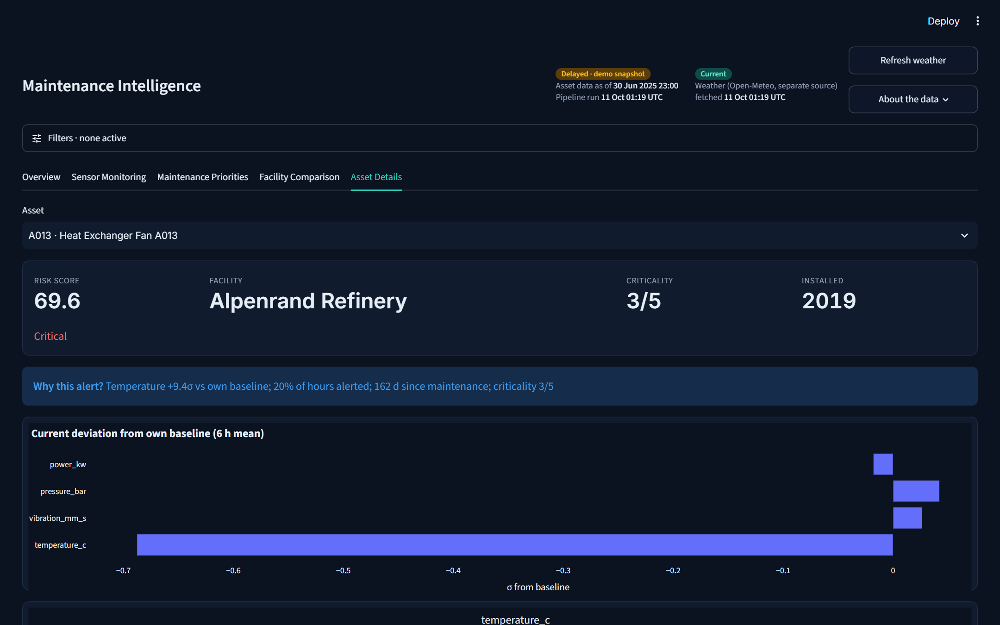

# Maintenance Intelligence

An explainable predictive-maintenance prototype. It turns six months of hourly sensor data from 100 **fictional** industrial assets (5 fictional European facilities) into a ranked, plain-language inspection list, with live weather context and an honest evaluation of the model.

Built with Python 3.12 · Pandas · NumPy · scikit-learn · Streamlit · Plotly · Requests · Pytest.


## Two versions of the dashboard

Both versions are Streamlit apps on the same analysis (`mi/`), so the risk scores and explanations are identical. Version 2 is a design iteration based on a review of version 1's screenshots.

### Version 1: first working dashboard


### Version 2: current (`app.py`)


### What changed, and why

| Area | Version 1 | Version 2 | Why |
|---|---|---|---|
| Page space | Large empty band above the title | Compact header with freshness status inline | More of the page is useful content. |
| Priorities table | Risk, severity and a long reason that was cut off | Adds **main driver** and **peak deviation (σ)**; the full reason appears when you select a row | Engineers see what is wrong at a glance, and nothing is truncated. |
| Maintenance Priorities tab | Large bar chart repeating the table beneath it | The table only, sized to the number of assets shown | The chart showed the same data twice. |
| Sensor charts | Raw field names (`temperature_c`), default colours, injected-fault overlay always on | Names with units (Temperature (°C)), shared hover, light grid, fault overlay off by default | Operational view first; the evaluation overlay is opt-in. |
| Asset details | Purple chart, large blue banner, and a "now" value that seemed to contradict the 7-day peak | Chart centred on zero with ±3σ limits, red only outside them; findings labelled "7 days to <date>" and the chart labelled "right now" | The two numbers measure different things and now say so. |
| Styling | Roughly 30 lines of injected CSS for cards, fonts, badges and tabs | Theme in .streamlit/config.toml (colours, Inter font, radius, borders, severity palette) and native badges and bordered containers; one line of CSS left for page padding | Survives Streamlit upgrades and is easier to maintain. |
| Severity colour | Teal progress bar even for Critical assets; severity word uncoloured | Severity cells tinted red/amber, with the word kept; charts use the same three fixed bands instead of a blended gradient | Colour now means the same everywhere and is never the only cue. |
| Facility Comparison | Raw field names, a red/cream scale, slanted labels | Readable labels, horizontal bars, shared severity colours, formatted table | Consistent with the rest of the app. |
| Navigation | Select a row, then find and open the Asset Details tab yourself | Selecting a row opens that asset in Asset details; the active tab is saved in the URL so a link or reload keeps your place | Fewer steps, and views can be shared. |
| Accessibility | Charts and tables without text descriptions | Every chart and table has an accessible description; sentence-case labels | Screen-reader users can identify each element. |
| First screen | Four totals, then a table | **Inspect next**: the top three assets with severity, risk, change versus 7 days earlier and the reason; KPIs show change versus 7 days earlier | Answers what to inspect first, and whether it is getting worse. |
| Sharing | Only the tab was in the link | Filters, risk date and selected asset are also in the link (?site=..&period=7&asset=A061) | A colleague opens the same view. |
| Facility view | Average risk per facility, which hides a single bad asset | Count of critical and warning assets per facility on the Overview and Facility comparison tabs, with averages kept in the table and heatmap | One failing asset is no longer averaged away. |
| Alert wording | Red dots on every sensor chart without explanation | Caption explains the model flags the whole asset, so dots appear on every chart | Avoids reading a sensor-specific fault into them. |
| Acting on a signal | Cards and tables were read-only | Each Inspect next card has an **Investigate** button; rows in both priorities tables open the asset | One click from a signal to its evidence. |
| Asset details | A 'right now' chart that seemed to contradict the 7-day peak | **7-day peak vs latest reading** side by side per sensor, with a plain-language caption | Explains how a recovering asset can still carry a high risk score. |
| Sensor labels | 'Show injected truth' | 'Show simulated fault periods' | Plain wording for an evaluation setting. |
| Data labels | A 'Delayed' badge that read like a failed refresh | 'Historical simulation · synthetic data' and 'Live weather', so the two sources are never confused | Customers shouldn't think a refresh failed. |
| Tables | Nine or ten narrow columns, facility names cut off | Seven focused columns in Overview, wider facility column, full explanation only in the priorities tab | Scannable at a glance. |
| Layout polish | Uneven KPI cards; large facility name competing with risk on Asset details | Equal-height KPI cards; facility shown as a small line; heatmap colour legend and shareable-link tip added | Consistent components and clear hierarchy. |
| Finding an asset | Asset list with no hint about how it was narrowed | Tooltip: type to search; the list follows the Facilities and Asset types filters | Discoverable without a second picker. |
| Reviewing several sites | Facilities hidden inside a collapsed filter panel | A visible **Sites** picker: choose one or several sites, with an 'In view' line (sites, asset count, assessment date) above every tab | You always know exactly which sites you are looking at. |
| Errors and empty states | Generic warning or a raw error | Plain messages for: data could not be prepared, no assets match (with a Clear filters button), a stale shared link, no readings or standby assets, weather unavailable for a site, and not enough history for the 7-day comparison | Nothing fails silently, and missing data is never shown as zero. |
| Consistency and wording | Investigate updated only one asset picker; Asset details showed the simulated fault bands by default; labels said 0.7 to 1.0 and 'maintenance overdue'; 'Analysis period' implied it changed the risk | One selected asset across tabs; fault bands off everywhere unless switched on; multiplier shown as about 0.64 to 1.0 and 'time since maintenance'; the window is called 'Chart and alert window', and risk is stated as always scored on the last 7 days | Numbers and labels now match what the code computes. |
| Header and reading order | Two stacked header buttons and a tall header before the first asset | One compact 'About · refresh' menu; the top-three assets sit higher; mobile padding reduced | The first decision is visible sooner. |
| Evidence in the priorities tab | A 'Why' column cut off at the table edge | Short table plus a readable 'Why each asset is flagged' list; the CSV keeps the full explanation and is dated | Nothing is clipped, and exports are reproducible. |
| Is it still happening? | Peak and latest bars only | A sentence stating the latest reading, its timestamp, and the 7-day peak | No interpretation needed. |
| Sensor monitoring | Four tall charts by default | Opens on the sensor driving that asset's risk; selected asset is kept in the shareable link | Less scrolling, and links reopen the same asset. |
| Inspect next cards | Risk, change and a long semicolon-separated explanation in one block | Risk score and 7-day change on top, one divider, then the evidence as two key figures (main driver with its deviation, hours alerted); the long text moved to Asset details | Scannable in a second; one idea per zone. |
| Tables | Rank missing, columns in an arbitrary order, change shown without colour | Rank, asset, equipment, site, risk, 7-day change (points, coloured), severity, then driver and peak; the risk formula moved into an expander | Columns follow the decision: what, where, how bad, why. |
| Choosing an asset | A plain list of IDs, and 'Why flagged' shown even for healthy assets | Each option shows type, site, risk and severity, highest risk first; healthy assets say 'Reading summary (not flagged)'; optional comparison of up to 4 assets in Asset details and overlay of up to 4 assets on one sensor | The assets that need attention are at the top, and several can be reviewed together. |
| Honest empty and edge states | 'Inspect next' always listed three assets, even if all were Normal; empty charts could crash; a shared link to an unavailable asset silently changed asset | Only flagged assets appear in 'Inspect next', with a clear message when none are; empty charts show a note; an unavailable asset in a link triggers a notice; no chart is drawn without readings; the 7-day and 30-day windows are labelled | The screen never implies a problem that is not there. |
| Telling someone | No way to pass an asset on | 'Compose email' on Asset details opens your email app with a ready-made message (asset, severity, risk, reason, date, and a link that restores the same sites, filters, window and asset); a 'Copy the message text instead' box is the fallback | Nothing is sent automatically and no recipients are invented; real notifications are listed under adoption gaps. |
| Small screens | Status badges wrapped over several lines | Badges stay on one line and stack cleanly on phones | Usable on a phone. |

| Version 1 | Version 2 |
|---|---|
|  |  |
|  |  |
## The problem

An operator of oil, gas and energy plants may have thousands of assets sending readings every hour. Nobody can watch every chart, and a fixed alarm limit (for example "vibration > X") is a poor fit: a healthy large compressor and a healthy small pump have very different normal values, and weather shifts temperatures even when nothing is wrong. The questions this project answers are:

1. **Which assets should a technician visit first?**
2. **Why** is each one flagged, in words a technician can check?
3. **How much can we trust that ranking?**

## The solution in one minute

| Step | What happens, in plain words | Why it matters |
|---|---|---|
| 1. Make the data | A program creates 100 pretend machines (pumps, compressors, motors...) with six months of hourly readings: temperature, vibration, pressure, power and running hours. It adds realistic problems: missing values, broken readings, and faults we hide on purpose and write down. | Real plant data is private. Because we know where the faults are, we can check honestly whether the system finds them. |
| 2. Add the weather | For each site we download the real outdoor temperature and humidity (free service Open-Meteo), plus today's live weather. If the internet is down, made-up weather is used instead. | A hot day makes a machine run warmer without anything being wrong. Knowing the weather prevents false alarms, and the app always starts. |
| 3. Tidy up | Remove obvious junk values (like -999), fill short gaps of up to 6 hours, and attach the weather to each reading. | Real sensors glitch. Dirty data gives wrong answers. |
| 4. Learn what is normal for each machine | Every machine is compared with **its own** usual behaviour, not with one rule for all. Weather is taken into account, and hours when the machine is switched off are ignored. | A big compressor and a small pump have very different normal values. One shared limit would be wrong for both. |
| 5. Spot unusual hours | A model called an Isolation Forest looks at all sensors together and marks hours that look strange for that machine. It only learns from the first part of the data and is tested on the later part. | It finds odd combinations (for example vibration slightly up while power is down) that a single limit would miss, and it needs no examples of past failures. |
| 6. Give each machine a risk score from 0 to 100 | The score mixes three things: how far readings drift from normal (50%), how often the machine was flagged (30%) and how long since its last maintenance (20%). It is then raised for machines that matter more. | A simple formula that an engineer can read and adjust, not a black box. It puts the machines to visit first at the top of the list. |
| 7. Explain it in a sentence | Each machine gets a short reason, for example: "Vibration +11.0σ vs own baseline; 7% of hours alerted; 4 d since maintenance; criticality 3/5" (σ means "how many typical steps above normal"). | People only act on a warning they understand and can check in the charts. |
### Anomaly detection is not failure prediction

The Isolation Forest says "this hour looks unlike this asset's normal". It does **not** say "this asset will fail in N days". Predicting failures needs labelled failure histories and many more failures than six months provide. The risk score therefore prioritises *inspection*, and the dashboard says so.

## The dashboard (version 2)

| Tab | What it shows |
|---|---|
| **Overview** | Data-freshness header, four KPIs, ranked priorities table, facility risk map, risk by facility, facility x asset-type heatmap, live weather per site, model performance. |
| **Sensor monitoring** | Any asset and sensor over 7/30/90 days, red dots for model alerts, optional orange bands (switch) for the injected, simulated fault periods. |
| **Maintenance priorities** | Top-N assets by risk with severity colours, full table with explanations, CSV download. |
| **Facility comparison** | Risk by facility and by facility x type, plus weather history. |
| **Asset details** | Risk, criticality, "why this alert?", current sensor deviation, 30-day trend and maintenance history. |

Severity is always colour **and** text: **Normal** (risk 25 or less), **Warning** (above 25 up to 40), **Critical** (above 40). The filters (sites, asset type, risk date and the 7/30/90-day chart window) apply to every tab. Risk itself is always scored on the 7 days before the risk date.

| Sensor monitoring | Maintenance priorities |
|---|---|
|  |  |
| **Facility comparison** | **Asset details** |
|  |  |

### Data freshness, stated honestly
The header shows the asset-data as-of time and the pipeline-run time separately from the weather fetch time. The asset data is a fixed synthetic snapshot, so it is labelled **Delayed · demo snapshot**, never "live". Weather shows **Current** or **Sync failed** from the actual API response.

## Results (held-out May-Jun 2025, hourly labels, real weather)

| Method | Precision | Recall | F1 |
|---|---|---|---|
| Isolation Forest | 0.83 | 0.65 | 0.73 |
| Simple rule (\|z\|>3) | 0.90 | 0.61 | 0.73 |

56 of 56 injected fault episodes were alerted, and 15 of 15 that ended in failure were alerted at least 6 h earlier (median 28 h). Accuracy is deliberately not reported: only about 1.2% of hours are anomalous, so it would be meaningless. The simple rule matches the forest here because synthetic faults have clean signatures. Numbers shift slightly with synthetic (offline) weather.

## Run it (Windows)

Install Python 3.12 (tick *Add python.exe to PATH*), then double-click **`run.bat`**, or:

```bash
py -3.12 -m venv .venv
.venv\Scripts\activate
pip install -r requirements.txt
streamlit run app.py
```

The first launch generates the data and runs the pipeline (about 15 s, longer while it downloads weather). It works offline.

```bash
python -m pytest        # 9 tests
python -m mi.data_gen   # regenerate CSVs (--offline skips the weather API)
```

## Project layout

```
app.py              dashboard
mi/data_gen.py      synthetic data generator
mi/weather.py       Open-Meteo client, cache, fallback
mi/pipeline.py      cleaning, features, Isolation Forest, risk score, evaluation
tests/test_mi.py    data quality, weather fallback, no-leakage, metrics, risk
docs/               data dictionary, architecture diagram, screenshots
data/               generated CSVs (sensor_readings.csv is regenerated on first run)
```

See [docs/data_dictionary.md](docs/data_dictionary.md) and [docs/architecture.md](docs/architecture.md).

## Design decisions

- **Per-asset baselines over global limits**, because "normal" differs per machine.
- **Isolation Forest over a supervised model**, because real plants rarely have enough labelled failures.
- **A hand-weighted risk score over a learned one**, because it is explainable and can be reviewed by a domain expert.
- **A synthetic fallback for weather**, so the project never fails to start.
- **Reported against a simple rule**, so the value of the model is measured, not assumed.

## Next steps
1. **Ask-the-data assistant (chatbot):** a chat box in the dashboard where a technician asks in plain language, e.g. *"Which pumps at Baltic Terminal got worse this week?"* or *"Why is A013 ranked first?"*. An LLM turns the question into a safe, read-only database query (or calls fixed tools such as `top_risks()` and `asset_history()`), runs it on the real database, and answers with the numbers and a link to the chart. Answers must come from query results, never from guessing, and are shown with the query used.
2. **Real database and data:** move from CSV files to a database (PostgreSQL or a time-series store) fed by the plant historian or maintenance system.
3. **Failure prediction:** with real failure records, add time-to-failure models and calibrated probabilities.
4. **Better models:** compare autoencoders or per-asset-type models, using a proper validation window.
5. **Operations:** scheduled refresh, alert notifications, Docker deployment, and a button to mark an alert as a false alarm so the system learns from it.
## Not in the demo (adoption gaps)
These are intentionally not faked: recording who reviewed or acknowledged an alert, review history, team permissions, scheduled shift reports, facility-level reports beyond the CSV exports, automatic notifications or messaging to responsible people (the demo only offers a manual compose-email), integration with a maintenance system, and validation of the risk score on real plant data. The score ranks assets for inspection; it is not a failure prediction.

## Limitations

Synthetic faults are cleaner than real ones. There is one model for the whole fleet. The alert quantile was chosen on the test period, so scores are slightly optimistic (a real project would use a separate validation window). Score weights are heuristics, not learned.

> All asset data is synthetic. Only the weather comes from a real source (Open-Meteo).
