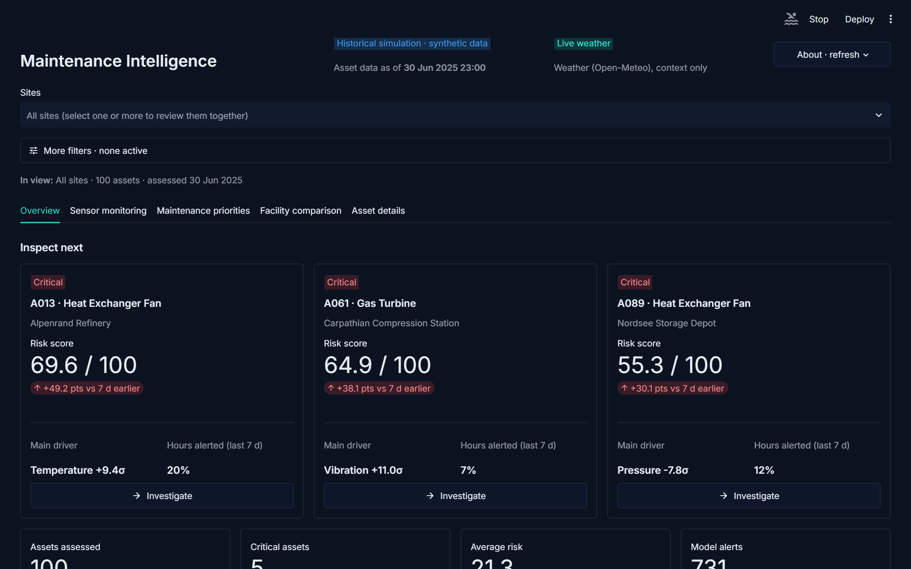
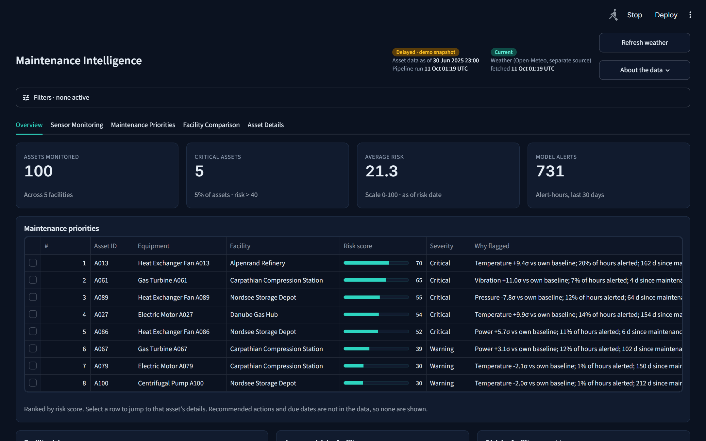
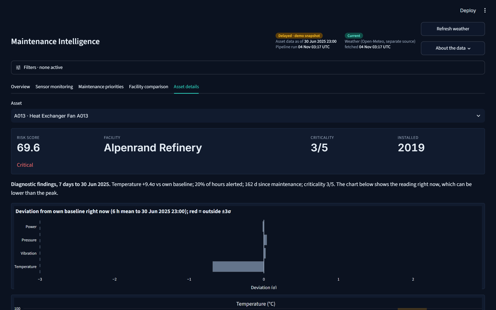
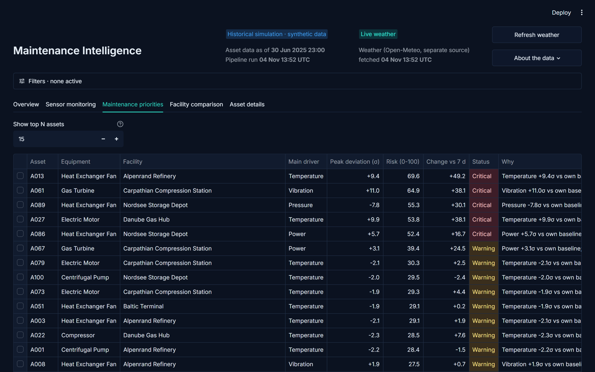
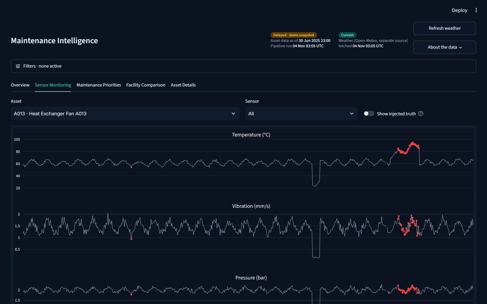
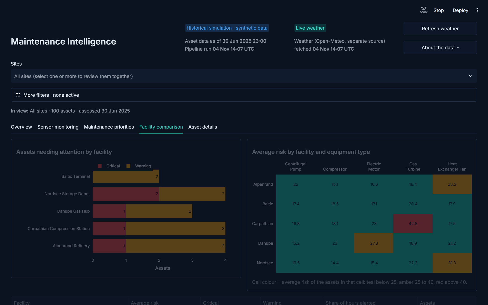
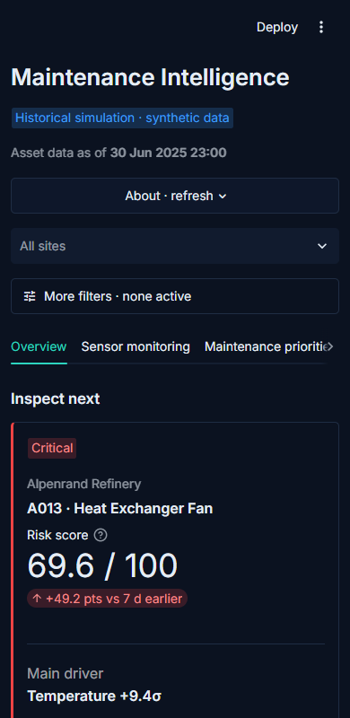
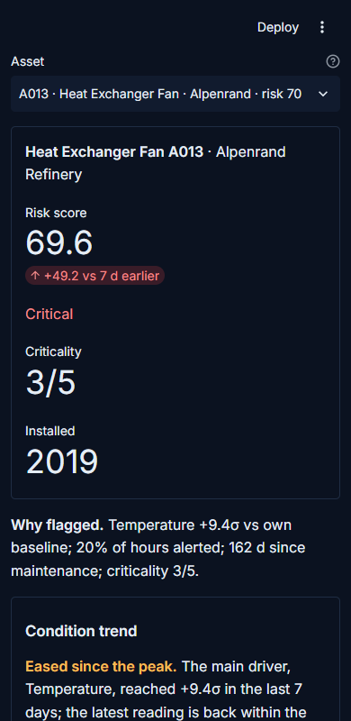

# Maintenance Intelligence

An explainable predictive-maintenance prototype. It turns six months of hourly sensor data from 100 **fictional** industrial assets (5 fictional European sites) into a ranked, plain-language inspection list, with live weather context and an honest evaluation of the model.

Python 3.12 · Pandas · NumPy · scikit-learn · Streamlit · Plotly · Requests · Pytest



> All asset data is synthetic. Only the weather comes from a real source (Open-Meteo). The risk score is a ranking index for inspections, **not** a failure prediction.

## Run it (Windows)

Install Python 3.12 (tick *Add python.exe to PATH*), then double-click **`run.bat`**, or:

```bash
py -3.12 -m venv .venv
.venv\Scripts\activate
pip install -r requirements.txt
streamlit run app.py
```

The first launch generates the data and runs the pipeline (about 15 s). It works offline. Tests: `python -m pytest` (9 tests).

## What you can do

- **Overview:** the assets to inspect first, each with risk, change versus a week earlier, main driver and hours alerted.
- **Asset details:** is the problem still happening (*Condition trend*), compare assets, compose an email with a link that reopens the same view.
- **Sensor monitoring, Maintenance priorities, Facility comparison:** the evidence, the full ranking (CSV export) and a site-by-site view.

Severity is always colour **and** word: **Normal** (risk 25 or less), **Warning** (above 25 up to 40), **Critical** (above 40).

## Version 1 and version 2

| Version 1 (first dashboard) | Version 2 (current `app.py`) |
|---|---|
|  |  |

Same analysis, redesigned interface: a compact header, structured cards, a **Condition trend** statement, readable tables, a shared selected asset, shareable links, honest empty and error states, and a native Streamlit theme. Every change and the reason for it: **[docs/design-changes.md](docs/design-changes.md)**.

## Screenshots

| Asset details | Maintenance priorities |
|---|---|
|  |  |
| **Sensor monitoring** | **Facility comparison** |
|  |  |

**On a phone (390 px wide)**

| Overview | Asset details |
|---|---|
|  |  |
## Walkthrough: one investigation in about 90 seconds

1. **Overview:** the header says the data is a *historical simulation*. *Inspect next* shows the three assets that need attention.
2. **Press Investigate** on the top asset (A013): risk 69.6, up 49.2 points in a week, temperature +9.4σ above its own normal.
3. **Condition trend:** is it still happening? Here: *eased since the peak*, with the 7-day peak next to the latest reading.
4. **Sensor monitoring:** same asset, opens on the sensor driving the risk; red dots are the model's flagged hours.
5. **Compare** it with other assets, then **Compose email**: your email app opens with the asset, reason, date and a link to this exact view. Nothing is sent for you.

## Results (held-out May to June 2025, hourly labels, real weather)

| Method | Precision | Recall | F1 |
|---|---|---|---|
| Isolation Forest | 0.83 | 0.65 | 0.73 |
| Simple rule (\|z\|>3) | 0.90 | 0.61 | 0.73 |

All 56 injected fault episodes were alerted, and 15 of 15 that ended in failure were alerted at least 6 h earlier (median 28 h). The simple rule matches the forest because synthetic faults have clean signatures. Accuracy is not reported: only about 1.2% of hours are anomalous.

## Documentation

- [How it works](docs/how-it-works.md): the problem, the seven-step pipeline, no-leakage design, anomaly detection versus failure prediction, design and product decisions
- [Design changes](docs/design-changes.md): version 1 to version 2, grouped by theme
- [Data dictionary](docs/data_dictionary.md) and [architecture](docs/architecture.md)

## Project layout

```
app.py              dashboard
mi/                 data_gen.py (synthetic data), weather.py (Open-Meteo, cache, fallback), pipeline.py (cleaning, Isolation Forest, risk score, evaluation)
tests/test_mi.py    data quality, weather fallback, no-leakage, metrics, risk
docs/               documentation and screenshots
data/               generated CSVs (sensor_readings.csv is regenerated on first run)
```

## Limits and next steps

**Not in the demo, on purpose:** recording who reviewed or acknowledged an alert, review history, team permissions, scheduled reports, automatic notifications (the demo only offers a manual compose-email), integration with a maintenance system, and validation of the risk score on real plant data.

**Limitations:** synthetic faults are cleaner than real ones; one model for the whole fleet; the alert quantile was chosen on the test period, so scores are slightly optimistic; score weights are heuristics, not learned.

**Next:** an ask-the-data assistant (plain-language questions answered from read-only queries, shown with the query used), a real database and data feed, failure prediction once real failure records exist, and notifications with acknowledgement and escalation.
