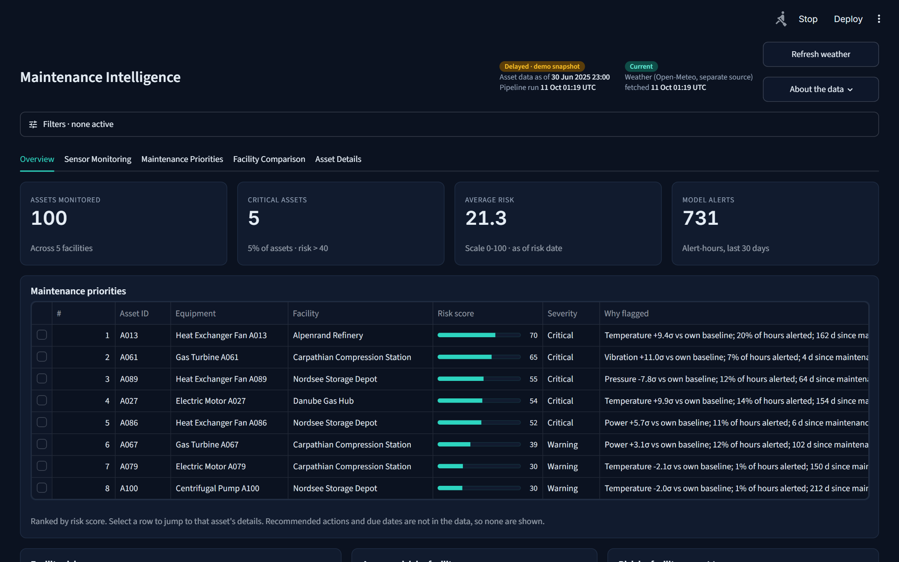
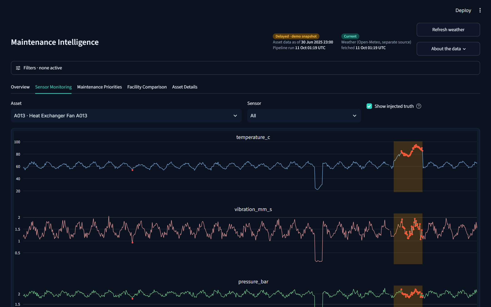
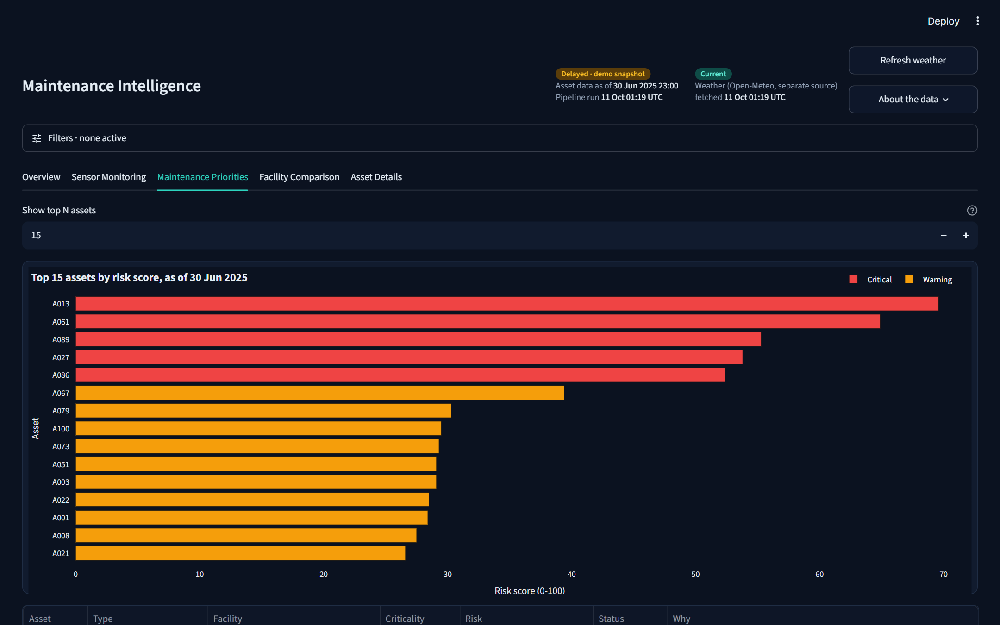
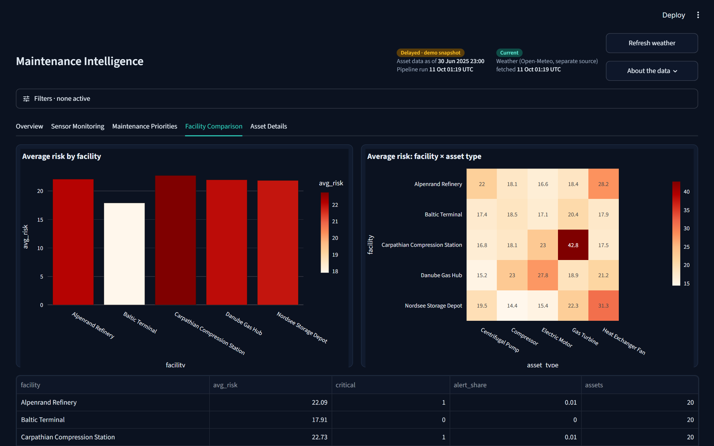
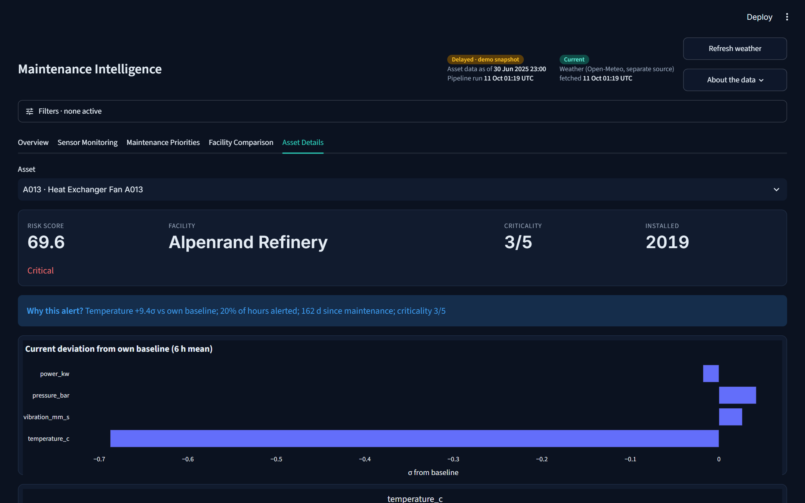

# Maintenance Intelligence

An explainable predictive-maintenance prototype. It turns six months of hourly sensor data from 100 **fictional** industrial assets (5 fictional European facilities) into a ranked, plain-language inspection list, with live weather context and an honest evaluation of the model.

Built with Python 3.12 · Pandas · NumPy · scikit-learn · Streamlit · Plotly · Requests · Pytest.



## The problem

An operator of oil, gas and energy plants may have thousands of assets sending readings every hour. Nobody can watch every chart, and a fixed alarm limit (for example "vibration > X") is a poor fit: a healthy large compressor and a healthy small pump have very different normal values, and weather shifts temperatures even when nothing is wrong. The questions this project answers are:

1. **Which assets should a technician visit first?**
2. **Why** is each one flagged, in words a technician can check?
3. **How much can we trust that ranking?**

## The solution in one minute

| Step | What happens | Why |
|---|---|---|
| 1. Data | A seeded generator creates 100 assets, hourly temperature / vibration / pressure / power / operating hours, maintenance history, missing values, sentinel codes (`-999`) and injected faults with known labels. | No real asset data is needed, runs are reproducible, and because faults are injected we can measure accuracy honestly. |
| 2. Weather | Open-Meteo archive gives real ambient temperature and humidity at each site; the forecast API gives live conditions. Responses are cached; on any failure it falls back to synthetic weather. | Outdoor temperature affects equipment temperature. Removing that effect avoids false alarms. The app must always start, even offline. |
| 3. Clean | Drop sentinel codes, interpolate short gaps (<= 6 h), join weather. | Real sensor data is messy. |
| 4. Per-asset baseline | Each asset is compared with **its own** normal (median / MAD robust z-scores), with temperature adjusted for ambient weather and standby hours ignored. | Removes the "big machine vs small machine" problem. |
| 5. Anomaly detection | An Isolation Forest scores how unusual each hour is across all sensors together. The alert threshold is the 99th percentile of **training** scores. | Catches combinations of sensors that no single limit would. Unsupervised: no failure labels needed. |
| 6. Risk score (0-100) | `0.5 x sensor deviation + 0.3 x share of alerted hours + 0.2 x maintenance overdue`, scaled by asset criticality (0.7-1.0). | A transparent formula that engineers can challenge and tune, unlike a black box. |
| 7. Explanation | Every asset gets a sentence such as *"Vibration +11.0σ vs own baseline; 7% of hours alerted; 4 d since maintenance; criticality 3/5"*. | Trust: the user can verify each claim in the sensor chart. |

**No data leakage.** The data is split by time (first 120 days to fit, the rest to evaluate). Baselines, weather adjustment, the forest and the threshold only ever see the training period. A test corrupts the test period and asserts that nothing fitted on the training period changes.

### Anomaly detection is not failure prediction

The Isolation Forest says "this hour looks unlike this asset's normal". It does **not** say "this asset will fail in N days". Predicting failures needs labelled failure histories and many more failures than six months provide. The risk score therefore prioritises *inspection*, and the dashboard says so.

## The dashboard

| Tab | What it shows |
|---|---|
| **Overview** | Data-freshness header, four KPIs, ranked priorities table, facility risk map, risk by facility, facility x asset-type heatmap, live weather per site, model performance. |
| **Sensor Monitoring** | Any asset and sensor over 7/30/90 days, red dots for model alerts, orange bands for the injected (true) fault episodes. |
| **Maintenance Priorities** | Top-N assets by risk with severity colours, full table with explanations, CSV download. |
| **Facility Comparison** | Risk by facility and by facility x type, plus weather history. |
| **Asset Details** | Risk, criticality, "why this alert?", current sensor deviation, 30-day trend and maintenance history. |

Severity is always colour **and** text: **Normal** (risk < 25), **Warning** (25-40), **Critical** (> 40). The filters (facility, asset type, 7/30/90-day period, risk date) apply to every tab.

| Sensor Monitoring | Maintenance Priorities |
|---|---|
|  |  |
| **Facility Comparison** | **Asset Details** |
|  |  |

### Data freshness, stated honestly
The header shows the asset-data as-of time and the pipeline-run time separately from the weather fetch time. The asset data is a fixed synthetic snapshot, so it is labelled **Delayed · demo snapshot**, never "live". Weather shows **Current** or **Sync failed** from the actual API response.

## Results (held-out May-Jun 2025, hourly labels, real weather)

| Method | Precision | Recall | F1 |
|---|---|---|---|
| Isolation Forest | 0.83 | 0.65 | 0.73 |
| Simple rule (\|z\|>3) | 0.90 | 0.61 | 0.73 |

56 of 56 injected fault episodes were alerted, and 15 of 15 that ended in failure were alerted at least 6 h earlier (median 28 h). Accuracy is deliberately not reported: only about 1.2% of hours are anomalous, so it would be meaningless. The simple rule matches the forest here because synthetic faults have clean signatures. Numbers shift slightly with synthetic (offline) weather.

## Run it (Windows)

Install Python 3.12 (tick *Add python.exe to PATH*), then double-click **`run.bat`**, or:

```bash
py -3.12 -m venv .venv
.venv\Scripts\activate
pip install -r requirements.txt
streamlit run app.py
```

The first launch generates the data and runs the pipeline (about 15 s, longer while it downloads weather). It works offline.

```bash
python -m pytest        # 9 tests
python -m mi.data_gen   # regenerate CSVs (--offline skips the weather API)
```

## Project layout

```
app.py              dashboard
mi/data_gen.py      synthetic data generator
mi/weather.py       Open-Meteo client, cache, fallback
mi/pipeline.py      cleaning, features, Isolation Forest, risk score, evaluation
tests/test_mi.py    data quality, weather fallback, no-leakage, metrics, risk
docs/               data dictionary, architecture diagram, screenshots
data/               generated CSVs (sensor_readings.csv is regenerated on first run)
```

See [docs/data_dictionary.md](docs/data_dictionary.md) and [docs/architecture.md](docs/architecture.md).

## Design decisions

- **Per-asset baselines over global limits**, because "normal" differs per machine.
- **Isolation Forest over a supervised model**, because real plants rarely have enough labelled failures.
- **A hand-weighted risk score over a learned one**, because it is explainable and can be reviewed by a domain expert.
- **A synthetic fallback for weather**, so the project never fails to start.
- **Reported against a simple rule**, so the value of the model is measured, not assumed.

## How it could be developed further

1. **Real data:** connect a historian or CMMS (for example PI, SAP PM) instead of the generator; the pipeline only needs the CSV schema in the data dictionary.
2. **Failure prediction:** with real failure labels, add survival analysis or gradient boosting for time-to-failure and report calibrated probabilities.
3. **Better detectors:** compare against autoencoders or LSTM models on subtle multi-sensor patterns, per-asset-type models, and a proper validation window to tune the alert threshold.
4. **Learned risk weights:** fit the score weights from maintenance outcomes instead of fixed expert weights.
5. **Actions:** recommended actions, due dates and work-order creation once the maintenance system provides them (they are intentionally not invented here).
6. **Operations:** scheduled refresh, alert notifications, user roles, Docker deployment, drift monitoring, and a feedback button so technicians can mark alerts as false positives.
7. **Product polish:** drill-through from table rows to asset pages, a narrow-screen filter drawer, and an offline-first PWA for field use.

## Limitations

Synthetic faults are cleaner than real ones. There is one model for the whole fleet. The alert quantile was chosen on the test period, so scores are slightly optimistic (a real project would use a separate validation window). Score weights are heuristics, not learned.

> All asset data is synthetic. Only the weather comes from a real source (Open-Meteo).
