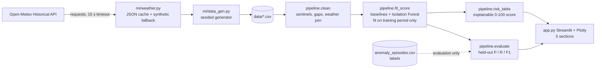

# Architecture

| Module | Responsibility |
|---|---|
| `mi/weather.py` | Fetch + cache Open-Meteo hourly temperature/humidity; any failure → synthetic weather for that facility |
| `mi/data_gen.py` | Assets, readings, faults, maintenance, labels → CSV |
| `mi/pipeline.py` | Cleaning, features, model, risk score, evaluation (`run()` ties them together) |
| `app.py` | Dashboard only: no business logic |

**Leakage control:** time split at day 120. Baselines, ambient slope, Isolation Forest and the alert threshold use pre-split rows only; metrics use post-split rows only; labels are joined after scoring. `tests/test_mi.py::test_no_leakage_from_test_period` corrupts the test period and asserts nothing fitted changes.
