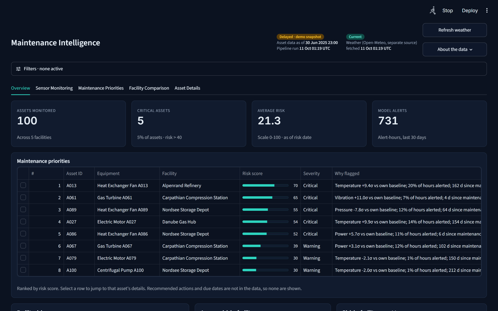
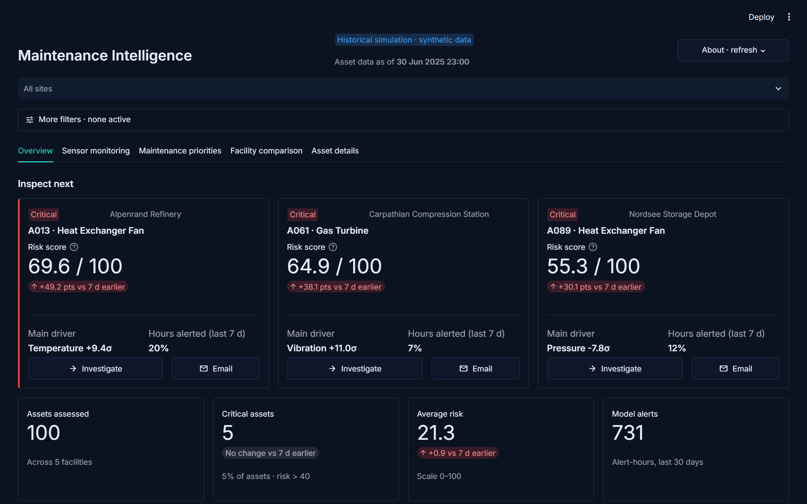
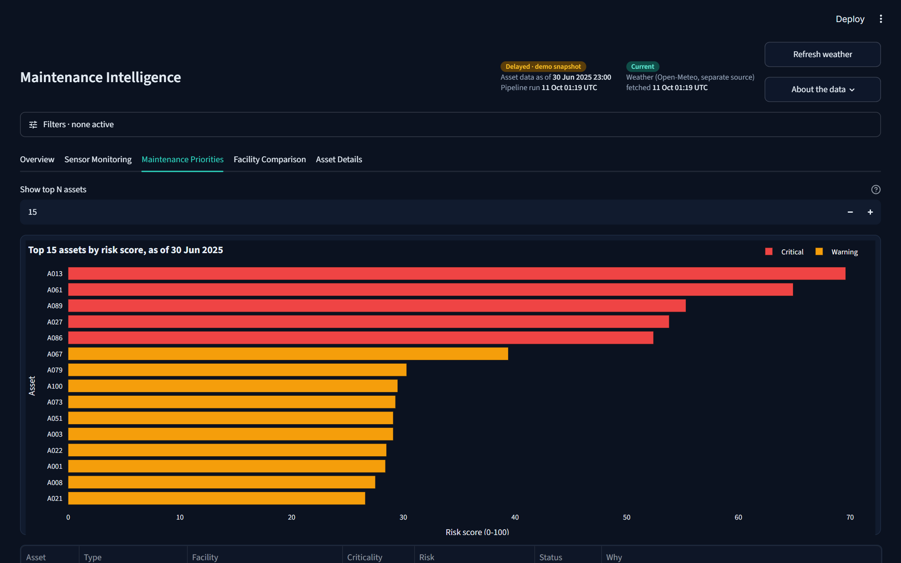
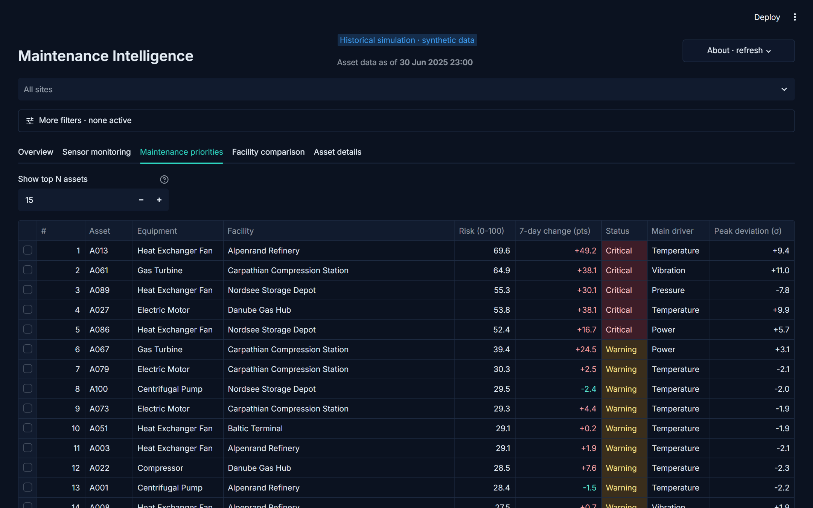
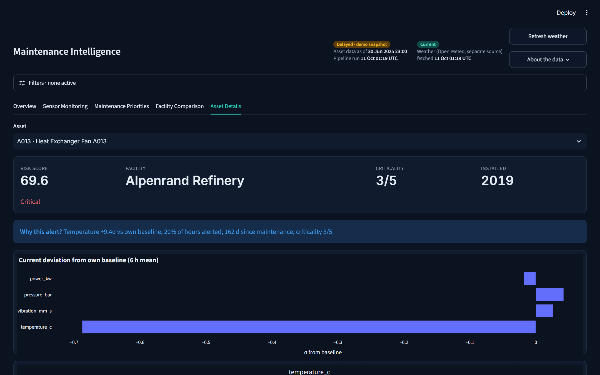
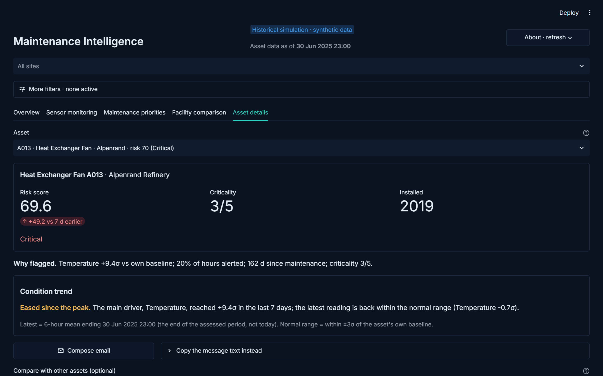
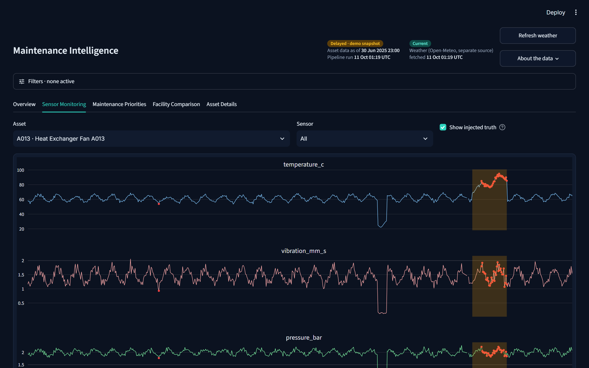
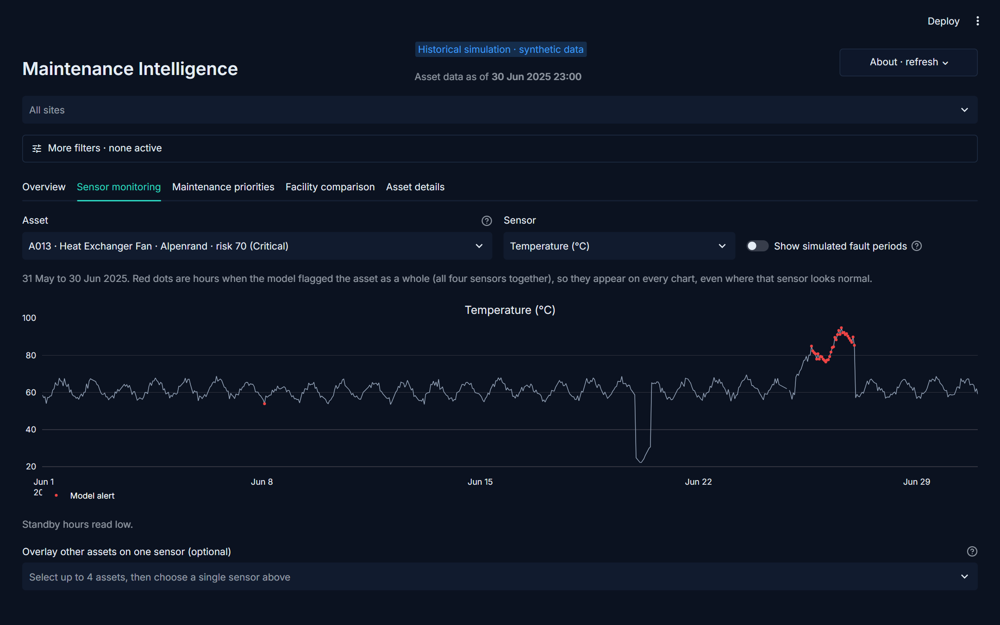
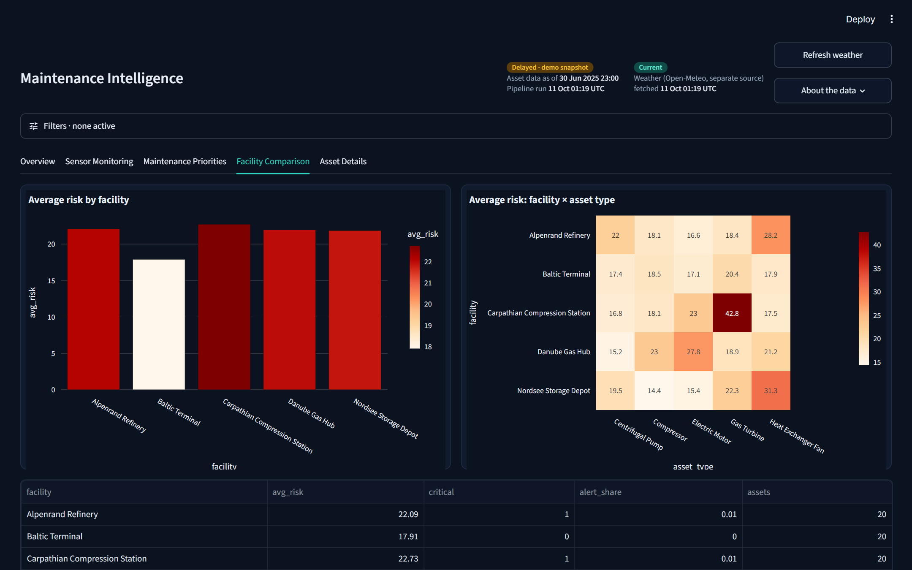
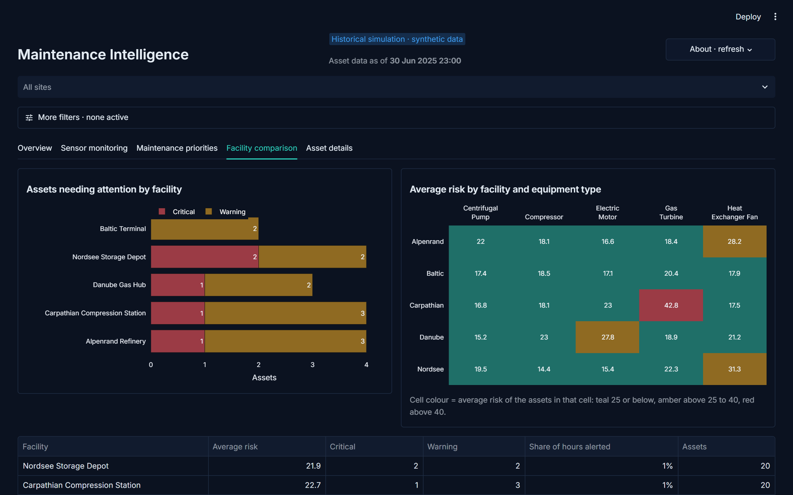

# Design changes: version 1 to version 2

Both versions run on the same analysis (`mi/`), so scores and explanations are identical. Version 2 is a design iteration, shaped by repeated design reviews of version 1's screenshots and by acceptance tests run in a real browser (desktop and a 390 px phone width).

Screenshots: [`screenshots/`](screenshots) (`v1-*` and `v2-*`).

## First screen and hierarchy
| Before | After |
|---|---|
| Tall header, large empty band, four totals before any asset | One compact header row; the "Historical simulation · synthetic data" label sits next to the title; weather status lives in the About menu |
| Three roomy cards with a long semicolon-separated explanation | **Inspect next**: severity and site on one row, risk score with 7-day change in points, one divider, then two key figures (main driver, hours alerted); the top asset has an accent edge |
| "Inspect next" always listed three assets | Lists only Critical or Warning assets, with a clear message when none are flagged |
| Score looked like a probability | A note and tooltips say it is a 0 to 100 priority index for ranking inspections, not a probability of failure |

## Tables and choosing assets
| Before | After |
|---|---|
| Rank missing, nine or ten narrow columns, facility names cut off | Rank, asset, equipment, site, risk, 7-day change (points, coloured), severity, then main driver and peak |
| A long "Why" column clipped at the table edge | A short table plus a readable "Why assets received these scores" list; the CSV keeps the full text and is dated |
| Teal bar even for Critical assets | Severity cells tinted red or amber, with the word kept |
| A plain list of asset IDs | Each option shows type, site, risk and severity, highest risk first; searchable by typing |

## Investigating one asset
| Before | After |
|---|---|
| A "now" chart that seemed to contradict the 7-day peak | **Condition trend** statement (still abnormal, eased since the peak, or within the normal range) above a peak-versus-latest chart, using the same main driver as the cards |
| "Why flagged" shown even for healthy assets | Healthy assets read "Reading summary (not flagged)" |
| Four tall sensor charts, fault overlay always on | Opens on the sensor that drives the risk; simulated fault periods are opt-in; units in the chart titles |
| One asset at a time | Compare up to four assets in a table, or overlay up to four on one sensor |

## Sites, sharing and navigation
| Before | After |
|---|---|
| Facilities hidden in a collapsed filter panel | A visible **Sites** picker (one or several) and an "In view" line above every tab |
| Selecting a row did nothing | Selecting a row, or pressing **Investigate**, opens that asset; one selected asset is shared across tabs |
| Only the tab was in the link | The page address holds sites, filters, window, date, tab and asset |
| No way to pass an asset on | **Compose email** opens your email app with a ready-made message and a link that reopens the same view; nothing is sent automatically |

## Honest states and errors
| Before | After |
|---|---|
| A "Delayed" badge that read like a failed refresh | "Historical simulation · synthetic data" and a separate weather status |
| Generic warnings, possible crashes on empty views | Plain messages for: data could not be prepared, no assets match (with a Clear filters button), a stale shared link, no readings or standby assets, weather unavailable for a site, and not enough history for the 7-day comparison |
| Labels that did not match the maths | Multiplier shown as about 0.64 to 1.0, "time since maintenance", Normal is 25 or less, "Chart and alert window" (risk is always scored on the last 7 days) |

## Visual system and accessibility
| Before | After |
|---|---|
| About 30 lines of injected CSS | Theme in `.streamlit/config.toml` (colours, Inter font, radius, borders, severity palette), native badges and containers; a few lines of CSS remain for page padding and the top-card accent |
| Blended red-to-teal gradients | Three fixed bands (Normal, Warning, Critical) used by every chart and table |
| Charts and tables without text descriptions | Every chart and table has an accessible description; sentence-case labels |
| Header badges wrapping on phones | Compact layout; tested on a 390 px phone width |

## Side by side

| Version 1 | Version 2 |
|---|---|
|  |  |
|  |  |
|  |  |
|  |  |
|  |  |